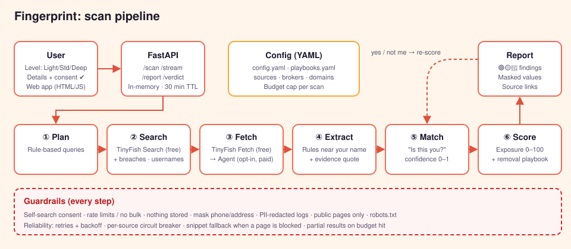

# Fingerprint: architecture

How a scan works, from "enter your name" to "here's how to remove it".



---

## 1. Flow at a glance

```
 User picks level ─► enters details ─► consent ✔
        │
        ▼
 ① PLAN      Claude turns inputs into targeted search queries
 ② SEARCH    Search APIs + breach lookup run in parallel
 ③ FETCH     TinyFish Fetch (fast) → TinyFish Agent (only if a page needs it)
 ④ EXTRACT   Claude pulls personal data points into strict JSON, with quotes
 ⑤ MATCH     Score "is this really you?" against what the user entered
 ⑥ SCORE     Sensitivity × confidence → exposure score + 🟢🟡🔴 labels
        │
        ▼
 Report ─► "Is this you?" (yes/no feeds back into ⑤) ─► removal steps
```

## 2. Inputs by level

| Level | Fields | Used for |
|---|---|---|
| Light | `full_name`, `city` | Name + place queries |
| Standard | + `email`, `username` | Breach lookup, username search across platforms, exact-match queries |
| Deep | + `phone`, `employer`, `school`, `past_cities` | Disambiguation (telling you apart from namesakes), people-finder checks |

All fields except name are optional. More fields mean higher match confidence and fewer false positives.

## 3. Pipeline steps

| # | Step | What it does | Tech | Output |
|---|---|---|---|---|
| ① | **Plan** | Builds 10–30 queries from the inputs, e.g. `"Asha Rao" Pune`, `"asha.rao@…"`, `site:linkedin.com "Asha Rao" Infosys` | Claude (small, fast model) | `Query[]` |
| ② | **Search** | Runs queries; checks email against breach DB; checks username on known platforms | Brave / Exa search API, HIBP API, username probe | `Hit[]` (url, title, snippet) |
| ③ | **Fetch** | Gets page text for promising hits only. Fetch first; Agent only for JS-heavy pages | TinyFish Fetch → Agent | `Page[]` |
| ④ | **Extract** | Finds personal data points on the page, quoting the evidence | Claude + JSON schema | `DataPoint[]` |
| ⑤ | **Match** | Confidence (0–1) that the page is about *this* user: overlapping fields, name rarity, location, user feedback | Rules + Claude tie-break | `Finding[]` with `confidence` |
| ⑥ | **Score** | Sensitivity weight × confidence → item risk; roll up to a 0–100 exposure score; attach removal playbook | Rules + playbook YAML | `Report` |

**Cheap first:** snippets alone often answer the question, so we fetch only hits that pass a snippet relevance filter. That cuts fetches and LLM calls by about 60–70%.

## 4. Data model

```jsonc
// Finding: one thing we found about the user
{
  "id": "f_07",
  "category": "contact",            // identity | contact | location | work | education | social | media | breach | broker
  "type": "phone",
  "value_masked": "98•••••210",     // full value never leaves the server
  "source_url": "https://example-peoplefinder.com/asha-rao-pune",
  "evidence": "…Asha Rao, Pune, Mobile: 98•••••210…",
  "confidence": 0.86,
  "sensitivity": "high",            // low | medium | high
  "risk": "red",                    // green | amber | red
  "removal": { "playbook": "peoplefinder_optout", "steps": ["…"], "link": "https://…/optout" },
  "user_verdict": null               // "me" | "not_me" | null
}
```

**Sensitivity weights:** phone, home address, DOB, ID numbers, breached passwords = **high** · email, employer, photos, family names = **medium** · name + city, public bio = **low**.

**Exposure score** = `min(100, Σ weight(sensitivity) × confidence)`, normalised and shown as a gauge with a one-line explanation.

## 5. Guardrails (privacy & safety layer)

| Guardrail | Where | How |
|---|---|---|
| Self-search consent | UI + API | Scan endpoint rejects requests without `consent: true` |
| Anti-abuse | API | Rate limit per IP/session; block bulk scans; no "search another person" mode |
| Ephemeral data | Storage | In-memory session store, 30-min TTL, no database of people |
| Masking | Extract → API | Sensitive values masked before leaving the server; logs pass through a PII redactor |
| Public only | Fetch | No logins, no paywall bypass, respect robots.txt, honest User-Agent |
| Evidence required | Extract | A data point without a quoted evidence span is dropped |
| No minors' data surfaced | Extract | Findings flagged as possibly about a minor are suppressed |

## 6. Design decisions

| Decision | Why | Trade-off |
|---|---|---|
| **User chooses detail level** | Respects privacy; Light still works for cautious users | Light gives more namesake noise. The "Is this you?" loop compensates |
| **"Is this you?" feedback loop** | Namesakes are the #1 accuracy problem; humans resolve it in a click | Needs one extra interaction |
| **Nothing stored** | Lowest-risk way to hold sensitive data is to not hold it | No history or "re-scan monthly" without opt-in storage (post-hackathon) |
| **Mask in the report** | A screenshot of the report shouldn't be a doxx | User sees slightly less detail; full value is behind the source link |
| **Search API first, agents last** | Fast and cheap; agents are slow and costly | Some JS-only pages need the Agent fallback |
| **Schema-validated JSON + evidence quotes** | Stops hallucinated findings; every claim is checkable | Slightly higher prompt cost |
| **Sources & playbooks in YAML** | Add a site or removal guide without code changes | Needs a schema check on load |

## 7. Scalability

- **Stateless workers:** each scan is independent, so we scale horizontally behind a queue.
- **Parallel fan-out:** queries and fetches run concurrently with per-domain rate limits.
- **Caching:** search results and fetched pages are cached by URL hash for a short TTL (pages, not people), so repeated popular-name scans are cheap.
- **Budget cap per scan:** max queries, fetches and tokens. The scan returns partial results instead of running up cost.
- **Config-driven sources:** a new platform, broker or removal guide is one YAML entry ([SOURCES.md](SOURCES.md)).

## 8. Reliability

| Failure | Response |
|---|---|
| Search API down / rate-limited | Fall back to the secondary search API |
| A site times out | Retry ×2 with backoff, then skip; report marks it "couldn't check" |
| Site keeps failing | Per-source circuit breaker opens for 5 min |
| LLM returns bad JSON | Re-ask once with the validation error, then drop that page |
| Budget hit | Stop and return what we have, flagged as partial |
| No internet at demo | **Mock mode** replays recorded fixtures for the demo persona |

**Run modes:** `LIVE` (real APIs) · `MOCK` (fixtures, offline, clearly labelled in the UI).

## 9. Tech stack

| Layer | Choice |
|---|---|
| Frontend | Next.js + Tailwind; Smudge animations in Lottie/CSS |
| API | FastAPI (Python 3.12), Pydantic models |
| Pipeline | asyncio workers; httpx; TinyFish SDK |
| AI | Claude (Haiku-class for planning/extract, Sonnet-class for tie-breaks) |
| Search | Brave Search API (primary), Exa (fallback) |
| Breaches | Have I Been Pwned API |
| Session store | In-memory (Redis with TTL in prod) |
| Ops | Docker, `/health`, structured JSON logs with PII redaction, pytest on fixtures |

## 10. API

| Method | Path | Purpose |
|---|---|---|
| `POST` | `/scan` | Start a scan `{level, fields, consent}` → `{scan_id}` |
| `GET` | `/scan/{id}/stream` | Server-sent events: live progress for the agent view |
| `GET` | `/scan/{id}/report` | Final report |
| `POST` | `/scan/{id}/verdict` | `{finding_id, verdict: me \| not_me}` → re-scored report |
| `DELETE` | `/scan/{id}` | Delete the session now |
| `GET` | `/health` | Liveness + dependency status |
