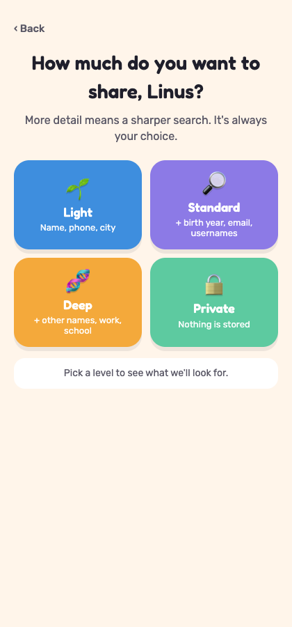
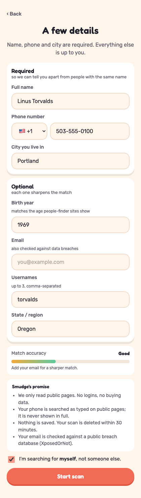
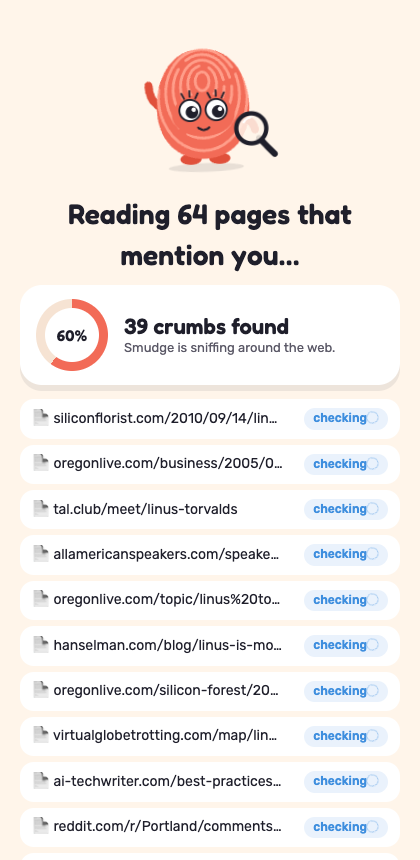
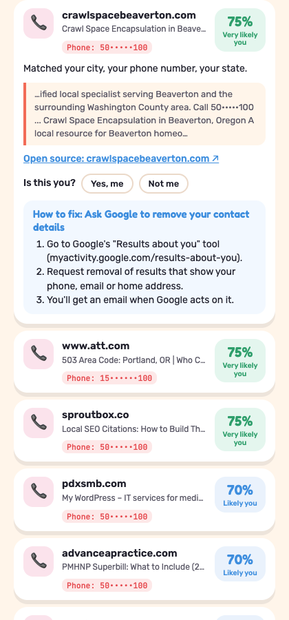

<p align="center"></p>

<h1 align="center">Fingerprint</h1>

<p align="center"><b>See what the internet knows about you, before someone else does.</b><br>
A self-scan for your digital footprint: what's public about you, where it lives, how likely it's really you, and how to remove it.</p>

<p align="center">
  <a href="https://fingerprint-pl6x.onrender.com"></a>
  <a href="https://youtu.be/Hvk0eetAfXI"></a>
</p>

<p align="center">
  <a href="https://youtu.be/Hvk0eetAfXI" title="Watch the Fingerprint demo on YouTube">
    
  </a><br>
  <sub>▶ Click the thumbnail to watch the 1-minute demo on YouTube · <a href="docs/media/fingerprint-demo.mp4">download the MP4</a></sub>
</p>

> **Live app:** https://fingerprint-pl6x.onrender.com. It runs on Render's free tier, so the first visit after a quiet spell can take about a minute to wake up.

---

## What it does

You enter your **name, phone and city**, plus anything else you choose to share. Fingerprint searches the live public web with **TinyFish**, reads the pages that mention you, and gives you a report:

- **What's exposed:** phone, email, address, age, workplace, school, family, profiles, data breaches.
- **Where:** every finding links to its source with a short, masked quote from the page.
- **Is it really you?** Every source shows a **confidence score** (*Very likely you · Likely you · Maybe you · Probably not you*) and the reasons behind it. Tap **"Not me"** and the report re-scores itself.
- **What to do:** a 0–100 exposure score, 🟢🟡🔴 risk labels, and step-by-step removal guides. Sort sources by risk or by how likely they're you.
- **Delete my data, step by step:** download a masked removal checklist, erase the scan from our server (verified on screen), then follow the tailored next steps for the sites that still show your info.

**Nothing is stored.** Scans live in memory for 30 minutes, values are masked on screen, and you can delete everything with one tap.

| Splash | Choose a level | Your details | Live scan | Sources + confidence |
|---|---|---|---|---|
|  |  |  |  |  |

<sub>Screens show a public figure with a fictional phone number (555 range).</sub>

## What we ask for

| | Fields | Why |
|---|---|---|
| **Required** | Full name · phone · city · country | The minimum needed to tell you apart from people with the same name |
| Optional (Standard) | Birth year · email · usernames · state | Age matching on listings, breach checks, accounts that use your handle |
| Optional (Deep) | Middle name · other names · workplace · school · past cities | The sharpest match, with the fewest namesakes |

We based these on what Optery, DeleteMe, Incogni and Google's "Results about you" ask for: [docs/INPUT-FIELDS.md](docs/INPUT-FIELDS.md).

## How it works

```
details + consent ──► ① Plan  rule-based queries (phone formats first, then name + place, site-targeted)
                      ② Search   TinyFish Search          ‖  breaches · Gravatar · username checks (free APIs)
                      ③ Fetch    TinyFish Fetch, top 20 pages; login-walled sites → snippet only
                                 └─ blocked people-finder → TinyFish Agent (real browser, opt-in, capped)
                      ④ Extract  phone / email / address / age / work / school near YOUR name, with a quote
                      ⑤ Match    weighted evidence → confidence + reasons ("matched your phone, your city")
                      ⑥ Score    risk per finding, exposure 0–100, removal playbook
                      ──► live progress (SSE) ──► report ──► "Is this you?" ──► delete
```

No AI model sees your data: planning, extraction and matching are deterministic rules, and every finding needs a quote from the page.

### TinyFish on the free tier

| TinyFish | What it does here | Cost |
|---|---|---|
| **Search** | Up to 28 targeted searches per scan, geo-targeted, with `include_domains` for people-finders, social, professional, code and document sites | Free daily allowance |
| **Fetch** | Reads the top 20 pages as markdown, 10 per call. Typed errors (`bot_blocked`, `login_required`) drive the next step | Free daily allowance |
| **Agent** | Opens a people-finder page that blocked Fetch, in a real browser with a goal + `output_schema`. Never logs in, pays or submits forms. Max 1 run per scan, 60 s cap | $0.016/step, opt-in (`AGENT_ENABLED`) |

Everything else is free too: XposedOrNot (breaches), Gravatar, the public GitHub, GitLab, Reddit, HN, DEV and Keybase APIs, and the Render free tier for hosting.

### Confidence, in short

Your phone (+0.55) and email (+0.50) count most; then username (+0.30), name (+0.25), an age that fits your birth year (+0.20), city, workplace, school and state. An age that contradicts yours (−0.35), a different middle initial, or a page that lists many people's numbers count against. A name alone is capped at 35%, and nothing without your name goes above 70%. [Details](docs/INPUT-FIELDS.md#3-how-confidence-is-calculated-backendapppipelinematchpy)

## Privacy & safety

- **Self-search only:** the API rejects scans without consent; 10 scans/hour per IP; no bulk mode.
- **Nothing stored:** in-memory sessions with a 30-minute TTL, plus `DELETE /api/scan/{id}`.
- **Masked everywhere:** phones show as `98•••••917`; any other run of digits in titles or quotes is fully dotted; logs are PII-redacted.
- **Public pages only:** login-walled sites are never fetched, and the Agent stops at any login, paywall or captcha.
- **Minimal sharing:** only your email goes to the breach database, and only a hash of it to Gravatar.

## Run it locally

```bash
python3 -m venv .venv && source .venv/bin/activate
pip install -r requirements-dev.txt
cp .env.example .env            # add TINYFISH_API_KEY (https://agent.tinyfish.ai/api-keys)
uvicorn backend.app.main:app --port 8765
# open http://localhost:8765   ·   health: http://localhost:8765/health
pytest -q                       # 43 tests
```

Settings (budgets, timeouts, rate limit) are in [`config.yaml`](config.yaml); sources and removal guides are in [`config/`](config/). Set `AGENT_ENABLED=true` to turn on the TinyFish Agent fallback.

## Deploy (free)

**Live:** https://fingerprint-pl6x.onrender.com · health check: https://fingerprint-pl6x.onrender.com/health

It runs as a single service: one Docker container where FastAPI serves both the API (`/api/*`) and the frontend (`/`). The repo includes a [`Dockerfile`](Dockerfile) and a Render blueprint ([`render.yaml`](render.yaml)). On Render, choose **New → Blueprint**, pick this repo, and enter `TINYFISH_API_KEY` and `AGENT_ENABLED` (`true` or `false`) when asked. Every push to `main` redeploys. Free instances sleep after 15 minutes idle, so open `/health` before a demo.

## Record the demo video

```bash
cp demo/persona.example.json demo/persona.json   # git-ignored; only someone who consented
python demo/record_demo.py                        # → demo/out/fingerprint-demo.mp4
```

This drives the real app in a phone frame with captions, speeds up the scan wait, and blurs the typed phone and email.

## Project layout

| Path | What's there |
|---|---|
| [`backend/app/`](backend/app/) | FastAPI app, TinyFish client, probes, guardrails, session store |
| [`backend/app/pipeline/`](backend/app/pipeline/) | `plan` → `runner` (search/fetch/agent) → `extract` → `match` → `score` |
| [`frontend/`](frontend/) | Plain HTML/CSS/JS, mobile-first, no build step |
| [`config/`](config/) | `sources.yaml` (platforms, domain groups), `playbooks.yaml` (removal steps) |
| [`demo/`](demo/) | Demo-video recorder (Playwright + phone-frame stage) |
| [`docs/`](docs/) | Design, input-field research, architecture diagram ([Eraser source](docs/architecture.eraserdiagram)) |
| [`submission/`](submission/) | Pitch, TinyFish write-up, judging criteria |

More: [aim.md](aim.md) (plain-English aim) · [HACKATHON.md](HACKATHON.md) · [PLAN.md](PLAN.md) · [SOURCES.md](SOURCES.md) · [docs/DESIGN.md](docs/DESIGN.md)

---

<p align="center"><sub>Fingerprint shows public information only. It isn't legal advice. Built for the Ignite Room hackathon.</sub></p>

## License

Fingerprint is licensed under the [PolyForm Noncommercial License 1.0.0](LICENSE). You are free to read, run, modify and share the code for personal, research, educational and other noncommercial purposes. **Commercial use is not permitted** without my written permission. For a commercial license, open an issue or reach out via [GitHub](https://github.com/arnavgupta28).
